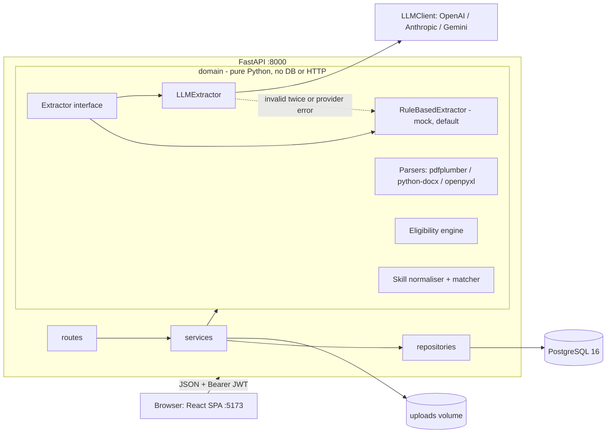

# DriveRadar

**Upload a campus placement notice, instantly see if you're eligible and what skills you're missing.**

[](https://github.com/sam-sebz/driveradar/actions/workflows/ci.yml)

## Problem

College students get dozens of placement notices every week as PDF, DOCX and XLSX files.
Each one buries the deadline, eligibility rules (CGPA, branch, backlogs, batch), bond terms
and required skills somewhere in the text. Students miss deadlines, and they apply to roles
they are not eligible for.

## Who it is for

- **Students** upload notices, keep a profile, and track every drive on one dashboard.
- **Placement coordinators** see anonymised, aggregated trends across all uploaded
  notices: top skills, role types and median CTC.

## Features

- Sign up / log in with JWT access tokens (15 min) and rotating refresh tokens.
- Upload a **PDF, DOCX or XLSX** (max 10 MB) or **paste text**. An XLSX sheet that lists
  several roles becomes one drive per role.
- **Structured extraction** into 20 fields: company, role, CTC, stipend, deadline (IST),
  bond and penalty, CGPA / % cut-offs, backlog limit, branches, batch, skills, selection
  rounds and more. Unknown values stay `null` and are never guessed.
  - Default `LLM_PROVIDER=mock`: an offline regex and keyword extractor. No API key needed.
  - `openai`, `anthropic` or `gemini`: an LLM with JSON-schema output, Pydantic
    validation and one retry with the validation error. If that still fails, it falls back
    to the rule extractor.
- **Eligibility engine** (pure Python, no LLM): eligible / not eligible / check manually,
  with a reason for every rule. It handles:
  - CGPA vs percentage (configurable factor)
  - branch synonyms and groups ("Computer Science or equivalent", "circuit branches")
  - CSE specialisations such as CSE-IT
  - missing data
- **Skill match** with synonym normalisation (`JS` = JavaScript, `Postgres` = PostgreSQL)
  over a 307-skill dictionary. Shows matched and missing skills.
- **Dashboard** sorted by deadline, with a "closes in < 24h" badge, eligibility, match %
  and your application status (saved / applied / shortlisted / rejected / selected).
- **"Edit if wrong"**: fix any extracted field, and eligibility and match are recomputed.
- **Coordinator analytics**: top 20 skills, drives by role type and median CTC. Duplicate
  uploads of the same notice are counted once, and no personal data is shown.

## Demo

> Screenshots and GIF: placeholders for the author to fill.

| Dashboard | Drive detail | Analytics |
|---|---|---|
| _screenshot TBD_ | _screenshot TBD_ | _screenshot TBD_ |

**Demo accounts** (created when `SEED_DEMO_DATA=true`, the default in `.env.example`):

| Role | Email | Password |
|---|---|---|
| Student | `demo@driveradar.dev` | `Demo@1234` |
| Coordinator | `coordinator@driveradar.dev` | `Demo@1234` |

The demo student is seeded with the three **synthetic** notices in
[`samples/synthetic/`](samples/synthetic/) (5 roles in total). Every company in them is
fictional.

## Architecture



More detail, including the ER diagram and request flows, is in
[docs/ARCHITECTURE.md](docs/ARCHITECTURE.md).

## Tech stack and why

| Layer | Choice | Why |
|---|---|---|
| API | Python 3.11, FastAPI, Pydantic v2 | Typed request validation and automatic OpenAPI docs; the parsing libraries are Python |
| Data | PostgreSQL 16, SQLAlchemy 2, Alembic | Relational data with `text[]` / `jsonb`, migrations run automatically on start |
| Parsing | pdfplumber, python-docx, openpyxl | Mature, permissive licences, no external services |
| AI | Rule-based by default; Anthropic SDK, OpenAI / Gemini REST behind one `LLMClient` interface | Works offline; changing provider is a config change |
| Auth | bcrypt, PyJWT, hashed rotating refresh tokens | Standard, explainable, no third-party identity service |
| Frontend | React 18, TypeScript (strict), Vite, React Router, TanStack Query, Tailwind, Recharts, zod | Server state cached by TanStack Query; zod checks API responses at runtime |
| Quality | pytest, ruff, mypy (strict), Vitest, Testing Library, ESLint | Fast feedback locally and in CI |
| Ops | Docker Compose with healthchecks, GitHub Actions | One command to run; CI runs the same command |

## Quick start

Needs Docker with Compose v2. No API key is needed.

```bash
git clone https://github.com/sam-sebz/driveradar.git
cd driveradar
cp .env.example .env
docker compose up --build
```

Then open **http://localhost:5173** and log in with a demo account. The API docs (Swagger)
are at **http://localhost:8000/docs**. The first start builds the images, runs the database
migrations and loads the demo data automatically.

**Task runner:** `make <target>` on Linux/macOS, `.\scripts\dev.ps1 <target>` on Windows.

| Target | What it does |
|---|---|
| `up` / `down` | start (waits until healthy) / stop the stack |
| `test` | backend + frontend tests with coverage (fails under 70%) |
| `lint` | ruff + ruff format check + mypy, ESLint + `tsc` |
| `seed` | load demo data into the running stack (idempotent) |
| `eval` | extraction accuracy on the labelled notices → `eval/results.md` |
| `smoke` | end-to-end check against the running stack |
| `setup` | install dev dependencies for `test` / `lint` / `eval` (Python 3.11, Node 20) |

## Configuration

All configuration comes from environment variables (see [`.env.example`](.env.example)).

| Variable | Default | Meaning |
|---|---|---|
| `POSTGRES_USER` / `POSTGRES_PASSWORD` / `POSTGRES_DB` | `driveradar` | Database created by Compose |
| `DATABASE_URL` | localhost URL | Only used when running the backend outside Docker |
| `JWT_SECRET` | dev-only value | Token signing key. **Replace it for any real deployment** |
| `ACCESS_TOKEN_MINUTES` / `REFRESH_TOKEN_DAYS` | `15` / `7` | Token lifetimes |
| `LOGIN_RATE_LIMIT_PER_MINUTE` | `5` | Login attempts per IP + email per minute |
| `CORS_ORIGINS` | `http://localhost:5173` | Comma-separated allowed origins |
| `VITE_API_URL` | `http://localhost:8000` | API address as seen by the browser (frontend build arg) |
| `MAX_UPLOAD_MB` | `10` | Upload size limit |
| `LLM_PROVIDER` | `mock` | `mock`, `openai`, `anthropic` or `gemini` |
| `LLM_MODEL` | empty | Optional override. Defaults: `claude-opus-5-5`, `gpt-4o-mini`, `gemini-2.5-flash` |
| `OPENAI_API_KEY` / `ANTHROPIC_API_KEY` / `GEMINI_API_KEY` | empty | Needed only for that provider. If missing, the app logs a warning and uses `mock` |
| `CGPA_TO_PERCENT_FACTOR` | `10` | percentage = CGPA × factor for UG percentage cut-offs |
| `SEED_DEMO_DATA` | `true` | Create demo users and load the synthetic notices on start |
| `LOG_LEVEL` | `INFO` | JSON logs, each line with a `request_id` |

## API reference

Interactive docs: **http://localhost:8000/docs**. Errors always look like
`{"error": {"code": "...", "message": "..."}}`.

| Method | Path | Who | Notes |
|---|---|---|---|
| POST | `/auth/signup` | anyone | Always creates a student |
| POST | `/auth/login` | anyone | Rate limited; returns access + refresh token |
| POST | `/auth/refresh` | refresh token | Rotates the token; re-use of an old token revokes all sessions |
| GET / PUT | `/me/profile` | logged in | PUT recomputes eligibility for all your drives |
| POST | `/drives/upload` | student | multipart `file` or `text`; returns `{"drives": [...]}` |
| GET | `/drives` | student | Yours, by deadline; filters `status`, `eligibility`, `closing_soon` |
| GET / PATCH / DELETE | `/drives/{id}` | owner | PATCH = "edit if wrong" (recomputes) |
| PATCH | `/drives/{id}/status` | owner | saved / applied / shortlisted / rejected / selected |
| GET | `/analytics/skills`, `/analytics/summary` | coordinator | Aggregates only |
| GET | `/health` | anyone | `{"status":"ok"}` after a DB round trip, else 503 |

## Testing

```bash
make test     # or .\scripts\dev.ps1 test
make lint
```

- **Backend:** 187 pytest tests. Unit tests cover the parsers, the 20+ eligibility cases,
  skill normalisation, the rule extractor, and the LLM retry/fallback logic with mocked
  HTTP. Integration tests cover auth, upload end to end, ownership, analytics and seeding.
  - Locally they run on in-memory SQLite.
  - With `TEST_DATABASE_URL` set (as in CI), the same tests run on PostgreSQL 16 with the
    Alembic migration applied. CI also runs `alembic check`, so models and migration
    cannot drift apart.
- **Frontend:** 24 Vitest tests: formatters, badges, the API client (token refresh), and
  the main flows (log in → dashboard → drive detail, upload, edit-if-wrong, profile,
  coordinator analytics) against a fake API.
- **Smoke:** `make smoke` runs [`scripts/smoke.py`](scripts/smoke.py) against the running
  stack. It checks health, sign-up, login, profile, uploading the synthetic PDF, extraction,
  eligibility and skill match, plus two error cases: a 415 for a fake PDF and a 401 with no
  token.
- **Coverage** (latest local run; raw reports in [`benchmarks/`](benchmarks/)):

| Scope | Line coverage | Raw output |
|---|---|---|
| Backend, all of `app/` | 97% | [`benchmarks/coverage_backend.txt`](benchmarks/coverage_backend.txt) |
| Backend core logic `app/domain/` | 98% | same file |
| Frontend `src/` | 95.43% | [`benchmarks/coverage_frontend.txt`](benchmarks/coverage_frontend.txt) |

## Measured results

Extraction accuracy of the default `mock` (rule-based) provider against hand-written
labels. Source: [`eval/results.md`](eval/results.md). Reproduce with
`make eval` (= `cd backend && python ../eval/run_eval.py`).

> ⚠️ **All evaluation notices are SYNTHETIC.** The in-sample notices were written by the
> same person who wrote the rules, so 100% there only shows the rules work on what they
> were built for. The held-out notice was written afterwards in a different style, and
> the rules were not tuned on it. **Real-world accuracy: TBD.** It needs real notices with
> labels in `eval/notices/real/` and `eval/labels/real/`.

| Notice set | Roles | Field accuracy (19 fields per role) | Exact-match rate |
|---|---|---|---|
| Synthetic, in-sample (`samples/synthetic/`) | 5 | 100.0% (95/95) | 100.0% (5/5) |
| Synthetic, held-out (`eval/notices/synthetic/`) | 1 | 84.2% (16/19) | 0.0% (0/1) |
| All | 6 | 97.4% (111/114) | 83.3% (5/6) |

Held-out misses: the job title under the label "Profile Offered:", the backlog rule
"Candidates with standing arrears are not eligible", and the selection rounds under the
heading "Process:".

LLM providers: **not measured**. No API key was used while building this.

Real users: **TBD**.

## Limitations

- **Rule-based extraction is brittle.** It misses labels and phrasings it was not written
  for (see the held-out errors above). The LLM providers are the intended fix, but they
  have not been measured.
- **The LLM providers are tested only against mocked HTTP responses**, not live APIs.
- **Scanned (image) PDFs are not supported:** there is no OCR, and the API returns a clear
  422 error instead.
- **The login rate limiter is in-memory**, so its counters are per API process. It needs
  Redis with more than one replica.
- **Tokens are kept in `sessionStorage`.** That is simple, but a successful XSS could read
  them. httpOnly cookies would be safer.
- **Assumptions:**
  - A CSE specialisation (for example CSE-IT) is treated as eligible for drives open to
    "CSE".
  - Percentage = CGPA × 10 unless configured otherwise.
  - Some colleges differ on both.
- **No email verification or password reset.** Coordinator accounts are created by the
  seed script or directly in the database, never through sign-up.
- **Uploaded files live on a local Docker volume** (one node). Migrations run on container
  start, which is fine for one replica only.

## Future work

- Measure the LLM providers on real, consented, anonymised notices; report cost and latency.
- OCR for scanned PDFs (Tesseract) behind the same parser interface.
- Deadline reminders (email or push) and calendar export (.ics).
- httpOnly-cookie refresh tokens, email verification and password reset.
- S3-compatible storage and a Redis rate limiter for horizontal scaling.
- Learn from "edit if wrong": `drives.extracted_original` already keeps the extractor's
  output next to the user-corrected values.

## Data and licences

- All bundled notices are **synthetic**, created by
  [`backend/scripts/make_samples.py`](backend/scripts/make_samples.py) and
  [`eval/make_heldout.py`](eval/make_heldout.py). No real company or student data is
  included.
- The skill dictionary ([`backend/data/skills.json`](backend/data/skills.json), 307
  skills) and branch list were written for this project
  ([`backend/scripts/skills_source.py`](backend/scripts/skills_source.py)).
- No ML models or third-party datasets are bundled.

## License

[MIT](LICENSE)
