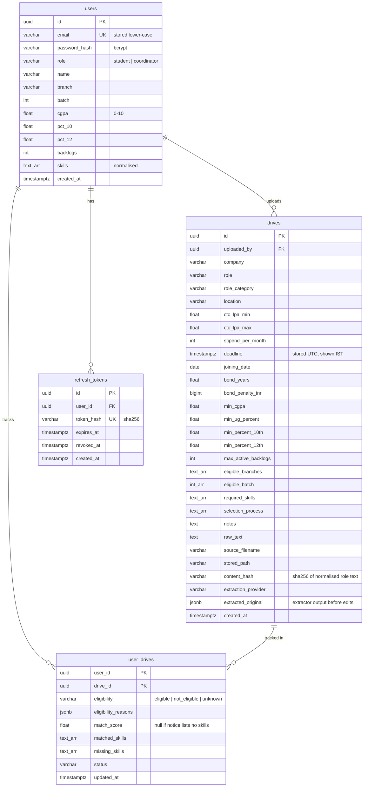
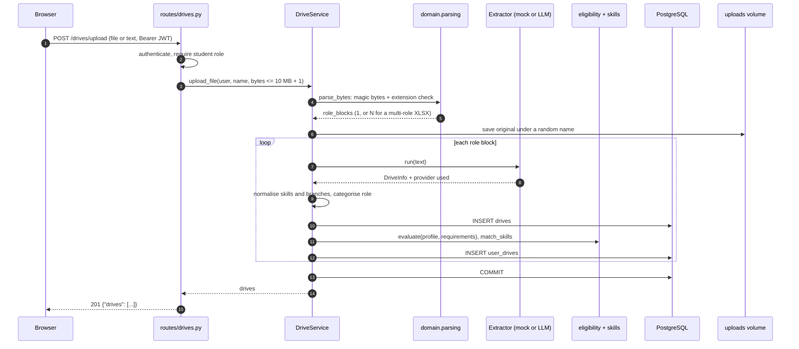
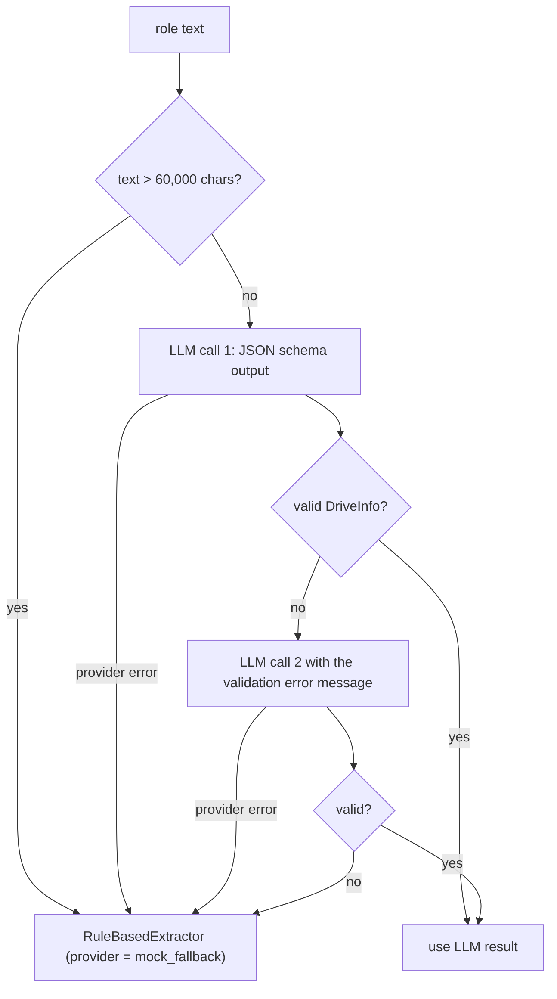

# DriveRadar architecture

## Layers

```
backend/app/
  api/routes/     HTTP only: validate input, call a service, shape the response
  services/       business logic and transactions (auth, drives, profile, analytics)
  repositories/   SQL queries (SQLAlchemy 2)
  models/         tables
  domain/         pure Python, no database and no HTTP: parsing, extraction, eligibility,
                  skills, role categories, LLM clients
  core/           config, logging, errors, security, rate limiting
```

Routes never contain business rules. The `domain` package can be unit-tested in
milliseconds and has its own coverage gate (≥70%; currently 98%).

## Data model



Indexes: `users(email)` unique, `drives(uploaded_by)`, `drives(deadline)`,
`drives(content_hash)`, `user_drives(user_id, status)`, `refresh_tokens(user_id)`.
Foreign keys cascade on delete. CHECK constraints guard `role`, `eligibility`, `status`
and the CGPA range.

**Why `user_drives` is separate from `drives`.** A drive is a fact about a notice. The
eligibility result, match score and status are facts about one student and that notice.
Keeping them apart means a profile change only recomputes `user_drives` rows, and it
leaves room to share one drive between students later.

## Request flow: upload



Failure paths:
- **Wrong type:** 415 `UNSUPPORTED_FILE`.
- **Too big:** 413 `FILE_TOO_LARGE`.
- **No text found:** 422 `EMPTY_DOCUMENT`.
- **Corrupt file:** 422 `UNREADABLE_FILE`.
- **Error after the file is saved:** the stored file is deleted and the transaction rolls
  back.

## Request flow: LLM extraction with fallback



Every result records which provider produced it (`drives.extraction_provider`).

## Request flow: auth

- **Signup / login:** bcrypt check, then a 15-minute HS256 access JWT
  (`sub`, `role`, `type=access`) plus an opaque refresh token. Only the token's SHA-256
  is stored. Login is rate limited per IP + email, and an unknown email still runs a bcrypt
  check so response time does not reveal which emails exist.
- **Refresh:** look up the hash, then:
  - if it was already revoked: revoke every token for that user (theft detection) → 401
  - if it has expired → 401
  - otherwise: revoke it and issue a new pair (rotation)
- **Every request:** the bearer JWT is verified, then the user is loaded, so a deleted
  user's token stops working at once.

## Observability

- Every log line is JSON with `request_id`. The ID is taken from an incoming
  `X-Request-ID` header or generated, and echoed back in the response header.
- Each request logs method, path, status and `duration_ms`. Extraction logs which provider
  ran and LLM latency. Uploaded text and file names are not logged.
- `GET /health` does a real `SELECT 1`. Docker healthchecks use it, and the frontend
  waits for a healthy backend.
